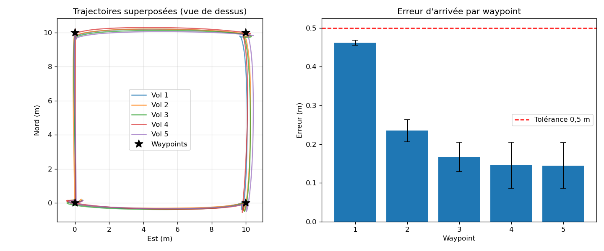
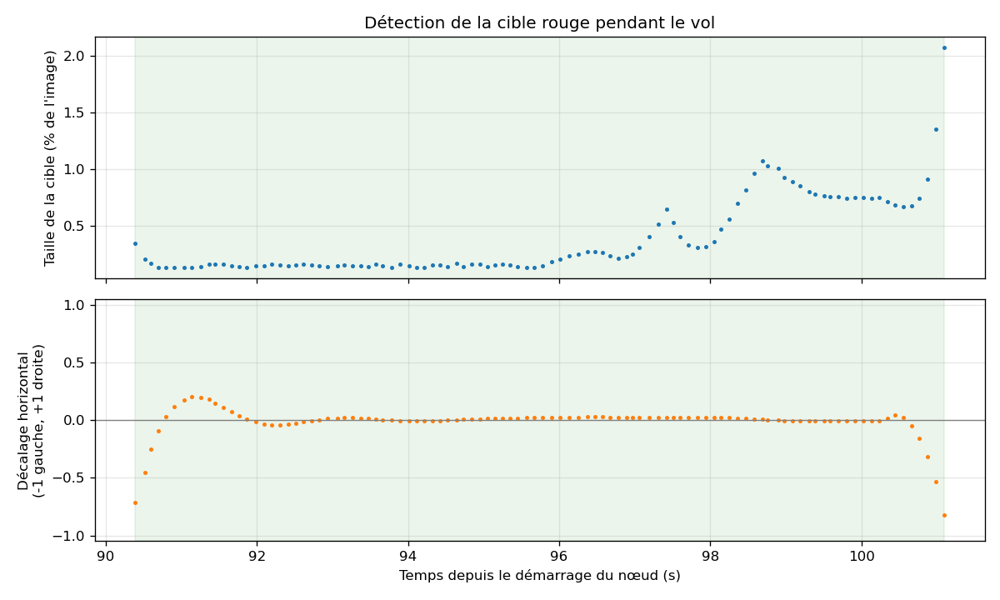
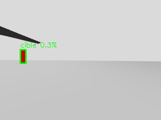
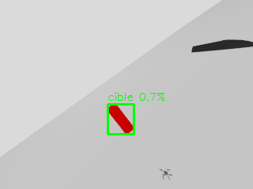
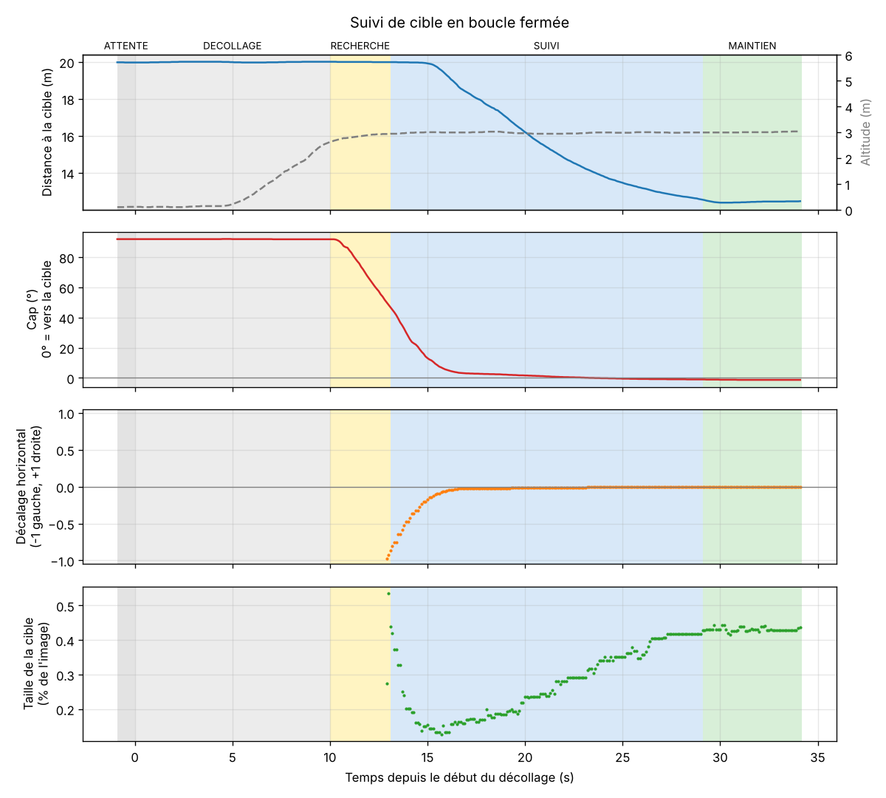
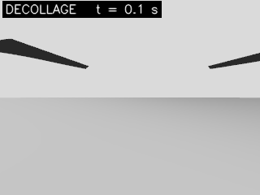

# Quadricoptère simulé : missions par waypoints et vision avec PX4, ROS 2 et Gazebo

[Read in English](README.md)

Un quadricoptère simulé (PX4 x500) qui décolle, exécute une mission par waypoints sous contrôle « offboard » ROS 2, détecte une cible colorée avec sa caméra embarquée et la suit en boucle fermée. Tout tourne sur un ordinateur portable modeste (ThinkPad L450, 15 Gio de RAM, Ubuntu 24.04), avec Gazebo lancé sans interface graphique.



## Résultats principaux

| Mesure | Résultat |
|---|---|
| Mission | Décollage à 5 m, carré de 10 m de côté, pause de 2 s à chaque waypoint, atterrissage |
| Répétabilité (5 vols, sans caméra) | 5/5 waypoints à chaque vol ; erreur d'arrivée **0,23 m en moyenne, 0,47 m au maximum** (tolérance 0,5 m) |
| Même mission avec caméra et détection actives | 5/5 waypoints ; erreur d'arrivée 0,42 m en moyenne, 0,49 m au maximum (un seul vol) |
| Durée d'un côté de 10 m | environ 2,4 à 2,5 s |
| Flux caméra (320×240) | **9,5 images/s** en moyenne sur 461 s (intervalle médian 0,100 s, maximal 0,39 s) |
| Détection de la cible (boîte rouge à 20 m au nord du départ) | vue sur **102 images consécutives** (10,7 s), et sur aucune des ~4 300 autres |
| Suivi de cible en boucle fermée (boîte rouge à 20 m au nord, un vol) | Le drone cherche, centre la cible en 2,4 s, s'approche et s'arrête à **12,4 m** (12,43 m en moyenne pendant le maintien de 5 s), erreur de cap −1,2° ± 0,1°, altitude 3,00 ± 0,01 m |

**Comment l'erreur d'arrivée est mesurée.** Un waypoint est considéré atteint dès que le drone passe à moins de 0,5 m, et l'erreur est la distance à cet instant. Elle est donc plafonnée par la tolérance (le waypoint 1, le décollage, affiche toujours environ 0,46 m) et dépend de la vitesse d'approche et de la boucle de contrôle à 10 Hz. C'est un indicateur grossier, pas la précision de positionnement du drone.

| Waypoint | Erreur d'arrivée (moyenne ± écart-type, 5 vols) | Durée du trajet |
|---|---|---|
| 1 (décollage) | 0,46 ± 0,01 m | 7,1 ± 0,2 s |
| 2 | 0,23 ± 0,03 m | 2,5 ± 0,1 s |
| 3 | 0,17 ± 0,04 m | 2,4 ± 0,0 s |
| 4 | 0,15 ± 0,06 m | 2,4 ± 0,1 s |
| 5 | 0,14 ± 0,06 m | 2,3 ± 0,1 s |

## Architecture

```
Gazebo (x500_mono_cam)                                  PX4 SITL (contrôleur de vol)
   │  image caméra                                           ▲
   ▼                                                         │ uXRCE-DDS
ros_gz_bridge ──► /drone/camera/image                micro-xrce-dds-agent
                       │                                     ▲
                       ▼                                     │ /fmu/in/*  /fmu/out/*
              detection_couleur.py                    offboard_mission.py
                       │                              (armement, mode offboard, waypoints, atterrissage)
                       ▼
              /drone/cible (geometry_msgs/Point)
              + images annotées + journal CSV
```

## Détection en vol

La cible est une boîte rouge de 1 × 1 × 3 m placée à 20 m au nord du point de décollage. La caméra est fixée au châssis et la mission oriente le drone dans sa direction de déplacement : la cible n'est donc visible que lorsque le drone regarde vers le nord.



Les temps sont en secondes depuis le démarrage du nœud de détection.

| Temps | Ce que montre le journal |
|---|---|
| 90,4 s | la cible entre par le bord gauche pendant que le drone pivote vers le nord |
| 91 à 96 s | centrée, environ 0,14 % de l'image (à environ 20 m) |
| 96 à 98,7 s | taille multipliée par 5 environ pendant que le drone avance de 10 m vers le nord |
| 97,6 à 98,2 s | creux : la cible est coupée par le bord bas de l'image |
| 99 à 100,5 s | environ 0,75 % pendant la pause au deuxième waypoint (à environ 10 m) |
| 101,1 s | le drone tourne vers l'est et la cible quitte le champ de vision |

Images annotées enregistrées par le détecteur (première et dernière du vol) :

<p>
  
  
</p>

## Suivi de cible en boucle fermée

`suivi_cible.py` ferme la boucle entre la caméra et le contrôleur de vol. Sa machine à états : décollage à 3 m, **recherche** (rotation sur place jusqu'à voir la cible), **suivi** (la vitesse de lacet est proportionnelle au décalage horizontal de la cible, et la vitesse d'avance diminue à mesure que la cible grossit dans l'image), **maintien** pendant 5 s à la distance d'arrêt, atterrissage. La distance d'arrêt n'est pas mesurée : elle est déduite de la taille apparente de la cible (arrêt à 0,45 % de l'image, environ 12 m). Limites de sécurité : 120 s au maximum, 40 m au maximum du point de départ, et atterrissage après un peu plus d'un tour complet sans voir la cible.



| Phase | Durée | Résultat |
|---|---|---|
| Décollage | 10,0 s | 5,4 s au sol avant de décoller, puis montée à 3 m |
| Recherche | 3,1 s | rotation antihoraire à 0,35 rad/s, cible vue à un cap d'environ 50° |
| Suivi | 16,0 s | cible centrée (décalage inférieur à 0,1) après 2,4 s, puis 7,6 m parcourus vers le nord à 1,1 m/s au plus |
| Maintien | 5,1 s | à 12,43 m de la cible en moyenne, cap −1,2° ± 0,09°, décalage −0,001, altitude 3,00 ± 0,01 m |
| Atterrissage | environ 12 s | descente, puis 6 s d'attente du désarmement automatique |

Environ 47 s de l'armement à la fin de l'atterrissage. La cible a été vue sur toutes les images pendant le suivi et le maintien.



Le GIF montre la vue de la caméra avec le cadre de détection et l'état du suivi. La caméra a fourni environ 8 images/s pendant ce vol, donc le GIF se lit environ 25 % plus vite que le temps réel.

**Taille apparente de la cible.** Ajustée sur les 211 images de ce vol (altitude 3 m) : taille ≈ 0,65 % × (10 m / distance)^2,03, la loi en inverse du carré attendue par la géométrie. La distance d'arrêt en découle.

## Contenu du dépôt

| Fichier | Rôle |
|---|---|
| `offboard_takeoff.py` | Premier nœud offboard : décollage, stationnaire, atterrissage |
| `offboard_mission.py` | Mission par waypoints, erreurs d'arrivée, CSV de trajectoire, retour en mode Hold après l'atterrissage |
| `vols_repetabilite.sh` | Enchaîne plusieurs vols puis lance l'analyse |
| `analyse_repetabilite.py` | Erreurs par waypoint, trajectoires superposées, histogramme |
| `capture_image.py` | Enregistre une image de la caméra en PNG |
| `spawn_cible.sh` | Place la boîte rouge dans le monde Gazebo en cours |
| `detection_couleur.py` | Détection du rouge (OpenCV, HSV), publie `/drone/cible`, enregistre des images annotées et un journal CSV |
| `analyse_detection.py` | Périodes de détection, cadence des images, graphique de taille et de position de la cible |
| `suivi_cible.py` | Suivi en boucle fermée : recherche, centrage, approche, maintien, atterrissage ; journal CSV |
| `enregistreur_gif.py` | Enregistre la vue caméra annotée en GIF pendant que le suivi tourne |
| `analyse_suivi.py` | Durée des phases, précision du maintien, loi de taille et figure d'un vol de suivi |

Les scripts utilisent le dossier `~/drone_ws` (les journaux sont écrits dans `~/drone_ws/logs`).

## Installation

Testé sous Ubuntu 24.04 avec ROS 2 Jazzy et la version de Gazebo (`gz sim`) installée par le script d'installation de PX4, avec la branche principale de PX4 clonée en octobre 2026. Compte environ 8 Go d'espace disque pour PX4, Gazebo et leurs dépendances.

1. Installer PX4 et ses dépendances :
   ```bash
   cd ~ && git clone https://github.com/PX4/PX4-Autopilot.git --recursive
   cd PX4-Autopilot && bash ./Tools/setup/ubuntu.sh
   ```
2. Installer le pont ROS 2 / Gazebo et les outils Python :
   ```bash
   sudo apt install ros-jazzy-ros-gz-bridge python3-opencv python3-matplotlib
   ```
3. Installer l'agent Micro XRCE-DDS (le paquet snap a fonctionné, voir les notes plus bas) :
   ```bash
   sudo snap install micro-xrce-dds-agent --edge
   ```
4. Compiler les messages PX4 :
   ```bash
   mkdir -p ~/drone_ws/src && cd ~/drone_ws/src
   git clone https://github.com/PX4/px4_msgs.git
   cd ~/drone_ws && source /opt/ros/jazzy/setup.bash && colcon build
   ```
5. Copier les scripts de ce dépôt dans `~/drone_ws`.
6. Alléger la caméra dans `PX4-Autopilot/Tools/simulation/gz/models/mono_cam/model.sdf` : image de 320 × 240 et fréquence de 10 Hz (par défaut 1280 × 960 à 30 Hz).
7. Installer QGroundControl (AppImage). PX4 refusait de s'armer sans liaison avec une station au sol.

## Lancer une mission avec détection

Ouvrir un terminal par étape, dans cet ordre :

```bash
# 1. Simulation sans fenêtre Gazebo
cd ~/PX4-Autopilot && HEADLESS=1 make px4_sitl gz_x500_mono_cam

# 2. Liaison PX4 <-> ROS 2
micro-xrce-dds-agent udp4 -p 8888

# 3. Pont de la caméra
source /opt/ros/jazzy/setup.bash
ros2 run ros_gz_bridge parameter_bridge '/world/default/model/x500_mono_cam_0/link/camera_link/sensor/camera/image@sensor_msgs/msg/Image[gz.msgs.Image' \
  --ros-args -r /world/default/model/x500_mono_cam_0/link/camera_link/sensor/camera/image:=/drone/camera/image

# 4. QGroundControl : attendre « Ready To Fly »

# 5. Détection
source /opt/ros/jazzy/setup.bash
PYTHONNOUSERSITE=1 python3 ~/drone_ws/detection_couleur.py

# 6. Cible, puis mission
~/drone_ws/spawn_cible.sh 0 20
source /opt/ros/jazzy/setup.bash && source ~/drone_ws/install/setup.bash
python3 ~/drone_ws/offboard_mission.py
```

Pour l'étude de répétabilité, lancer `~/drone_ws/vols_repetabilite.sh 5` à la place de l'étape 6, puis ouvrir `~/drone_ws/logs/repetabilite.png`. Un journal de détection s'analyse avec `PYTHONNOUSERSITE=1 python3 ~/drone_ws/analyse_detection.py`.

### Suivi en boucle fermée

Mêmes étapes 1 à 5, puis :

```bash
# 6. Enregistreur de GIF (attend le démarrage du suivi)
source /opt/ros/jazzy/setup.bash
PYTHONNOUSERSITE=1 python3 ~/drone_ws/enregistreur_gif.py

# 7. Cible, puis suivi
~/drone_ws/spawn_cible.sh 0 20
source /opt/ros/jazzy/setup.bash && source ~/drone_ws/install/setup.bash
python3 ~/drone_ws/suivi_cible.py
```

Analyser ensuite le vol avec `PYTHONNOUSERSITE=1 python3 ~/drone_ws/analyse_suivi.py`. Le drone démarre vers l'est et la cible est au nord : la recherche tourne donc dans le sens antihoraire (`SENS_RECHERCHE` dans le script).

## Notes et enseignements

- **Topics versionnés.** Les noms des topics PX4 portent des suffixes de version (par exemple `/fmu/out/vehicle_local_position_v1`). Ils dépendent des versions de PX4 et de `px4_msgs` : vérifier d'abord avec `ros2 topic list`.
- **Atterrissage.** Passer en mode Hold dès que l'altitude descendait sous 0,3 m interrompait l'atterrissage et laissait le drone en vol stationnaire. Le script attend désormais 6 s après le contact (PX4 se désarme tout seul) avant de quitter le mode offboard.
- **Cadence de la caméra.** Avec une image de 1280 × 960 à 30 Hz et la fenêtre Gazebo ouverte, la caméra ne dépassait pas environ 1,8 image/s. Après avoir réduit la résolution à 320 × 240, la fréquence à 10 Hz et lancé Gazebo avec `HEADLESS=1`, elle s'est maintenue autour de 9,5 images/s.
- **Conflit NumPy.** Un NumPy 2 installé dans `~/.local` faisait planter `matplotlib` et OpenCV (compilés pour NumPy 1). Lancer les scripts avec `PYTHONNOUSERSITE=1` règle le problème.
- **Agent Micro XRCE-DDS.** La compilation de la v2.4.2 depuis les sources échouait, car la branche Fast-DDS qu'elle télécharge (`2.12.x`) n'existe plus. Le paquet snap a fonctionné.
- **Tester avant de voler.** La machine à états du suivi a d'abord été exécutée contre un drone et une caméra simulés en Python. Cela a révélé un défaut avant tout vol : avec une vitesse d'approche purement proportionnelle, le drone ralentissait sans jamais atteindre le seuil d'arrêt. Une vitesse minimale et une marge d'arrivée (93 % de la taille visée) l'ont corrigé.
- **Champ de vision de la caméra.** La cible est apparue quand le cap est passé sous environ 50°, ce qui suggère un champ de vision horizontal d'environ 100° (mon premier modèle supposait 72°). Le suivi est resté fluide malgré tout.

## Limites

- Simulation uniquement, dans un seul monde vide, avec une seule cible rouge et des seuils HSV fixes réglés sur l'éclairage de Gazebo.
- Cinq vols forment un petit échantillon, et la comparaison avec la charge de la caméra repose sur un seul vol.
- La caméra est fixée au châssis, donc l'image s'incline quand le drone penche (l'horizon atteignait environ 35° sur une image). Un suivi en boucle fermée devrait compenser cette inclinaison.
- Le suivi n'a été volé qu'une fois, sur une cible fixe, sans vent. La distance d'arrêt est déduite de la taille apparente de la cible, pas mesurée.
- Les scripts utilisent des chemins `~/drone_ws` écrits en dur.

## Suites prévues

- Détection d'objets avec YOLO via ONNX Runtime, pour éviter une installation lourde de PyTorch.
- Compensation de l'inclinaison de l'image pendant les manœuvres.
- Suivi d'une cible mobile.

## Auteur

Emmanuel Noubimboo PEKO — [GitHub](https://github.com/pekoemmanuel) · [LinkedIn](https://linkedin.com/in/pekoemmanuel)
