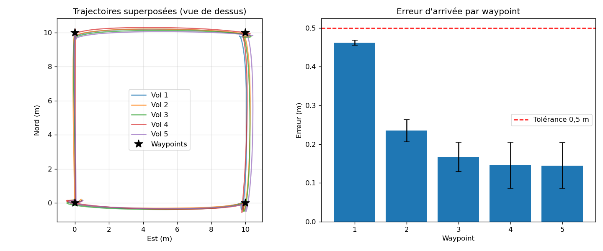
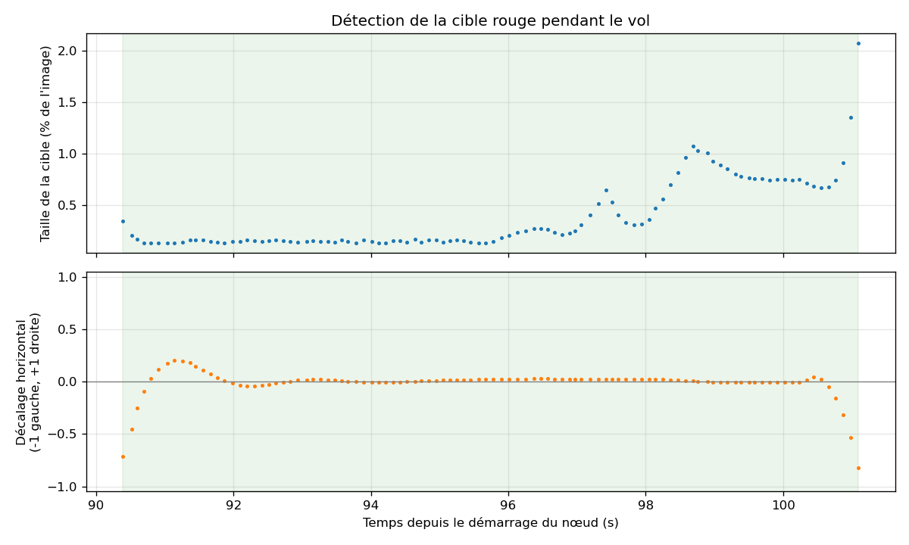
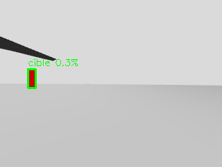
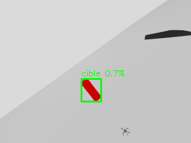
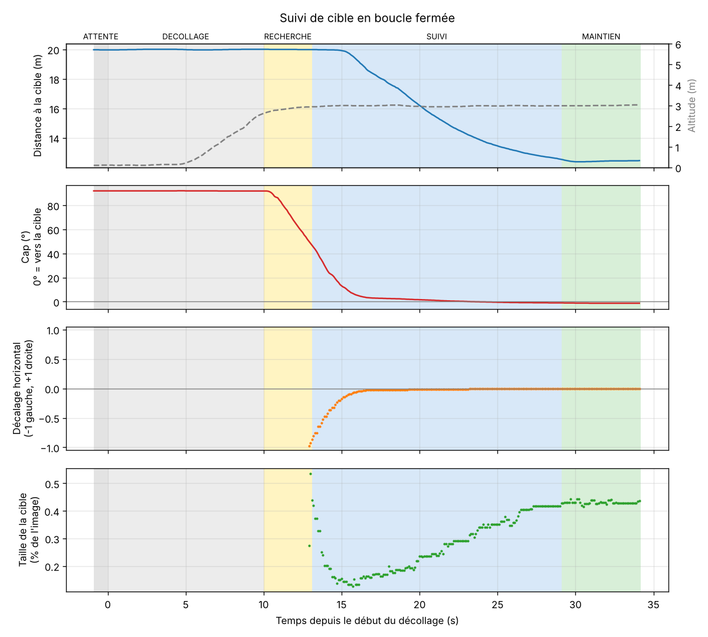
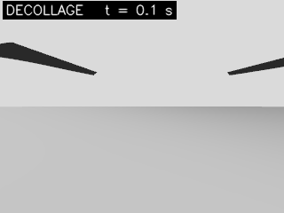
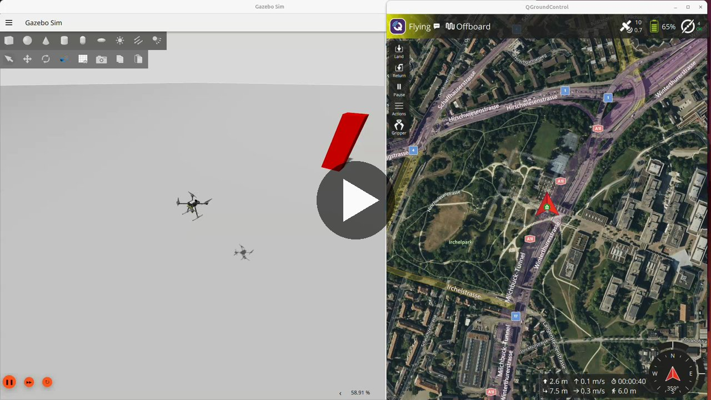

# Simulated quadcopter: waypoint missions and vision with PX4, ROS 2 and Gazebo

[Lire en français](README.fr.md)

A simulated quadcopter (PX4 x500) that takes off, flies a waypoint mission under ROS 2 offboard control, detects a coloured target with its onboard camera, and tracks it in closed loop. Everything runs on a modest laptop (ThinkPad L450, 15 GiB RAM, Ubuntu 24.04), with Gazebo, which can run without its window to keep the camera rate up.



## Key results

| Measure | Result |
|---|---|
| Mission | Take-off to 5 m, square with 10 m sides, 2 s pause at each waypoint, landing |
| Repeatability (5 flights, no camera) | 5/5 waypoints each time; arrival error **0.23 m on average, 0.47 m at most** (tolerance 0.5 m) |
| Same mission with camera and detection running | 5/5 waypoints; arrival error 0.42 m on average, 0.49 m at most (one flight) |
| Time to fly one 10 m leg | about 2.4 to 2.5 s |
| Camera stream (320×240) | **9.5 images/s** on average over 461 s (median interval 0.100 s, longest 0.39 s) |
| Target detection (red box 20 m north of the start) | seen on **102 consecutive images** (10.7 s), and on none of the ~4,300 other images |
| Closed-loop target tracking (red box 20 m north, one flight) | The drone searches, centres the target within 2.4 s, approaches and stops at **12.4 m** (12.43 m on average over the 5 s hold), heading error −1.2° ± 0.1°, altitude 3.00 ± 0.01 m |

**How the arrival error is measured.** A waypoint counts as reached the first time the drone gets within 0.5 m of it, and the error is the distance at that instant. It is therefore capped by the tolerance (waypoint 1, the take-off, always reads about 0.46 m) and depends on the approach speed and the 10 Hz control loop. Read it as a coarse indicator, not as the drone's positioning accuracy.

| Waypoint | Arrival error (mean ± std, 5 flights) | Leg time |
|---|---|---|
| 1 (take-off) | 0.46 ± 0.01 m | 7.1 ± 0.2 s |
| 2 | 0.23 ± 0.03 m | 2.5 ± 0.1 s |
| 3 | 0.17 ± 0.04 m | 2.4 ± 0.0 s |
| 4 | 0.15 ± 0.06 m | 2.4 ± 0.1 s |
| 5 | 0.14 ± 0.06 m | 2.3 ± 0.1 s |

## Architecture

```
Gazebo (x500_mono_cam)                                  PX4 SITL (flight controller)
   │  camera image                                           ▲
   ▼                                                         │ uXRCE-DDS
ros_gz_bridge ──► /drone/camera/image                micro-xrce-dds-agent
                       │                                     ▲
                       ▼                                     │ /fmu/in/*  /fmu/out/*
              detection_couleur.py                    offboard_mission.py
                       │                              (arm, offboard mode, waypoints, land)
                       ▼
              /drone/cible (geometry_msgs/Point)
              + annotated images + CSV log
```

## Detection in flight

The target is a red 1 × 1 × 3 m box placed 20 m north of the take-off point. The camera is fixed to the airframe and the mission turns the drone towards its direction of travel, so the target is visible only while the drone faces north.



Times are in seconds since the detection node started.

| Time | What the log shows |
|---|---|
| 90.4 s | the target enters from the left edge while the drone turns to the north |
| 91 to 96 s | centred, about 0.14 % of the image (about 20 m away) |
| 96 to 98.7 s | size multiplied by about 5 as the drone flies 10 m north |
| 97.6 to 98.2 s | dip: the target is cut by the bottom edge of the image |
| 99 to 100.5 s | about 0.75 % during the pause at the second waypoint (about 10 m away) |
| 101.1 s | the drone turns east and the target leaves the field of view |

Annotated frames saved by the detector (first and last of the flight):

<p>
  
  
</p>

## Closed-loop target tracking

`suivi_cible.py` closes the loop between the camera and the flight controller. Its state machine: take-off to 3 m, **search** (turn on the spot until the target is seen), **tracking** (the yaw rate is proportional to the horizontal offset of the target, and the forward speed decreases as the target grows in the image), **hold** for 5 s at the stand-off distance, landing. The stand-off distance is not measured: it is inferred from the apparent size of the target (stop at 0.45 % of the image, about 12 m). Safety limits: 120 s maximum, 40 m maximum from the start, and landing after a bit more than one full turn without seeing the target.



| Phase | Duration | Result |
|---|---|---|
| Take-off | 10.0 s | 5.4 s on the ground before lift-off, then climb to 3 m |
| Search | 3.1 s | anticlockwise turn at 0.35 rad/s, target seen at a heading of about 50° |
| Tracking | 16.0 s | target centred (offset below 0.1) after 2.4 s, then 7.6 m flown north at up to 1.1 m/s |
| Hold | 5.1 s | 12.43 m from the target on average, heading −1.2° ± 0.09°, offset −0.001, altitude 3.00 ± 0.01 m |
| Landing | about 12 s | descent, then 6 s waiting for the automatic disarm |

About 47 s from arming to the end of the landing. The target was seen on every image during tracking and hold.



The GIF shows the camera view with the detection box and the tracking state. This flight was run with the Gazebo window open, as in the video below. The camera delivered about 8 images/s, so the GIF plays about 25 % faster than real time.

**Flight video.** [`results/simulation_vol.mp4`](results/simulation_vol.mp4) (72 s, 5.4 MB) is a screen recording of the tracking flight analysed above: the figures, the GIF and the camera rate all come from this same run, made with the Gazebo window open. It shows the Gazebo window (external view, with the red target) next to QGroundControl (mode, battery, distance from the start, heading). The GIF shows what the drone sees, the video shows what the drone does. The map is PX4's default simulated home position, not a real location.

[](results/simulation_vol.mp4)

**Apparent size of the target.** Fitted on the 211 images of this flight (altitude 3 m): size ≈ 0.65 % × (10 m / distance)^2.03, the inverse-square law expected from geometry. The stand-off distance follows from it.

## Repository content

| File | Role |
|---|---|
| `offboard_takeoff.py` | First offboard node: take-off, hover, landing |
| `offboard_mission.py` | Waypoint mission, arrival errors, trajectory CSV, return to Hold mode after landing |
| `vols_repetabilite.sh` | Runs several flights in a row, then the analysis |
| `analyse_repetabilite.py` | Per-waypoint errors, superimposed trajectories, bar chart |
| `capture_image.py` | Saves one camera frame as PNG |
| `spawn_cible.sh` | Places the red target box in the running Gazebo world |
| `detection_couleur.py` | Red detection (OpenCV, HSV), publishes `/drone/cible`, saves annotated frames and a CSV log |
| `analyse_detection.py` | Detection periods, image rate, plot of target size and position |
| `suivi_cible.py` | Closed-loop tracking: search, centring, approach, hold, landing; CSV log |
| `enregistreur_gif.py` | Records the annotated camera view as a GIF while the tracker runs |
| `analyse_suivi.py` | Phase durations, hold accuracy, size law and figure for a tracking flight |

The scripts use the folder `~/drone_ws` (logs are written to `~/drone_ws/logs`).

## Setup

Tested on Ubuntu 24.04 with ROS 2 Jazzy and the Gazebo (`gz sim`) version installed by PX4's setup script, using the PX4 main branch cloned in October 2026. Count about 8 GB of disk space for PX4, Gazebo and their dependencies.

1. Install PX4 and its dependencies:
   ```bash
   cd ~ && git clone https://github.com/PX4/PX4-Autopilot.git --recursive
   cd PX4-Autopilot && bash ./Tools/setup/ubuntu.sh
   ```
2. Install the ROS 2 / Gazebo bridge and Python tools:
   ```bash
   sudo apt install ros-jazzy-ros-gz-bridge python3-opencv python3-matplotlib
   ```
3. Install the Micro XRCE-DDS Agent (the snap worked; see the notes below):
   ```bash
   sudo snap install micro-xrce-dds-agent --edge
   ```
4. Build the PX4 messages:
   ```bash
   mkdir -p ~/drone_ws/src && cd ~/drone_ws/src
   git clone https://github.com/PX4/px4_msgs.git
   cd ~/drone_ws && source /opt/ros/jazzy/setup.bash && colcon build
   ```
5. Copy the scripts of this repository into `~/drone_ws`.
6. Lighten the camera in `PX4-Autopilot/Tools/simulation/gz/models/mono_cam/model.sdf`: set the image to 320 × 240 and the update rate to 10 Hz (the default is 1280 × 960 at 30 Hz).
7. Install QGroundControl (AppImage). PX4 refused to arm without a ground-station link.

## Running a mission with detection

Open one terminal per step, in this order:

```bash
# 1. Simulation without the Gazebo window (drop HEADLESS=1 to watch the flight or record a video)
cd ~/PX4-Autopilot && HEADLESS=1 make px4_sitl gz_x500_mono_cam

# 2. PX4 <-> ROS 2 link
micro-xrce-dds-agent udp4 -p 8888

# 3. Camera bridge
source /opt/ros/jazzy/setup.bash
ros2 run ros_gz_bridge parameter_bridge '/world/default/model/x500_mono_cam_0/link/camera_link/sensor/camera/image@sensor_msgs/msg/Image[gz.msgs.Image' \
  --ros-args -r /world/default/model/x500_mono_cam_0/link/camera_link/sensor/camera/image:=/drone/camera/image

# 4. QGroundControl: wait for "Ready To Fly"

# 5. Detection
source /opt/ros/jazzy/setup.bash
PYTHONNOUSERSITE=1 python3 ~/drone_ws/detection_couleur.py

# 6. Target, then mission
~/drone_ws/spawn_cible.sh 0 20
source /opt/ros/jazzy/setup.bash && source ~/drone_ws/install/setup.bash
python3 ~/drone_ws/offboard_mission.py
```

For the repeatability study, run `~/drone_ws/vols_repetabilite.sh 5` instead of step 6, then open `~/drone_ws/logs/repetabilite.png`. Analyse a detection log with `PYTHONNOUSERSITE=1 python3 ~/drone_ws/analyse_detection.py`.

### Closed-loop tracking

Same steps 1 to 5, then:

```bash
# 6. GIF recorder (waits for the tracker to start)
source /opt/ros/jazzy/setup.bash
PYTHONNOUSERSITE=1 python3 ~/drone_ws/enregistreur_gif.py

# 7. Target, then tracking
~/drone_ws/spawn_cible.sh 0 20
source /opt/ros/jazzy/setup.bash && source ~/drone_ws/install/setup.bash
python3 ~/drone_ws/suivi_cible.py
```

Then analyse the flight with `PYTHONNOUSERSITE=1 python3 ~/drone_ws/analyse_suivi.py`. The drone starts facing east and the target is to the north, so the search turns anticlockwise (`SENS_RECHERCHE` in the script).

## Notes and lessons learned

- **Versioned topics.** PX4 topic names carry version suffixes (for example `/fmu/out/vehicle_local_position_v1`). They depend on the versions of PX4 and `px4_msgs`, so check `ros2 topic list` first.
- **Landing.** Switching to Hold mode as soon as the altitude drops under 0.3 m interrupted the landing and left the drone hovering. The script now waits 6 s after touchdown (PX4 disarms by itself) before leaving offboard mode.
- **Camera rate.** With a 1280 × 960 image at 30 Hz and the Gazebo window open, the camera reached only about 1.8 images/s. After lowering the resolution to 320 × 240, the rate to 10 Hz, and running Gazebo with `HEADLESS=1`, it held about 9.5 images/s.
- **NumPy conflict.** A NumPy 2 installed in `~/.local` made `matplotlib` and OpenCV (built for NumPy 1) crash. Running the scripts with `PYTHONNOUSERSITE=1` avoids it.
- **Micro XRCE-DDS Agent.** Building v2.4.2 from source failed because the Fast-DDS branch it fetches (`2.12.x`) no longer exists. The snap package worked.
- **Testing before flying.** The tracker's state machine was first run against a simulated drone and camera in Python. That exposed a bug before any flight: with a purely proportional approach speed, the drone slowed down without ever reaching the stop threshold. A minimum speed and an arrival margin (93 % of the target size) fixed it.
- **Camera field of view.** The target appeared when the heading dropped below about 50°, which suggests a horizontal field of view of about 100° (my first model assumed 72°). The tracking stayed smooth anyway.

## Limitations

- Simulation only, in a single empty world, with one red target and fixed HSV thresholds tuned to Gazebo's lighting.
- Five flights are a small sample, and the camera-load comparison rests on a single flight.
- The camera is fixed to the airframe, so the image tilts when the drone leans (the horizon reached about 35° in one frame). A closed-loop tracker would have to compensate for it.
- Tracking was flown once, on a fixed target, with no wind. The stand-off distance is inferred from the apparent size of the target, not measured.
- The scripts use hard-coded `~/drone_ws` paths.

## Roadmap

- Object detection with YOLO through ONNX Runtime, to avoid a heavy PyTorch install.
- Compensation of the image tilt during manoeuvres.
- Tracking of a moving target.

## Author

Emmanuel Noubimboo PEKO — [GitHub](https://github.com/pekoemmanuel) · [LinkedIn](https://linkedin.com/in/pekoemmanuel)
